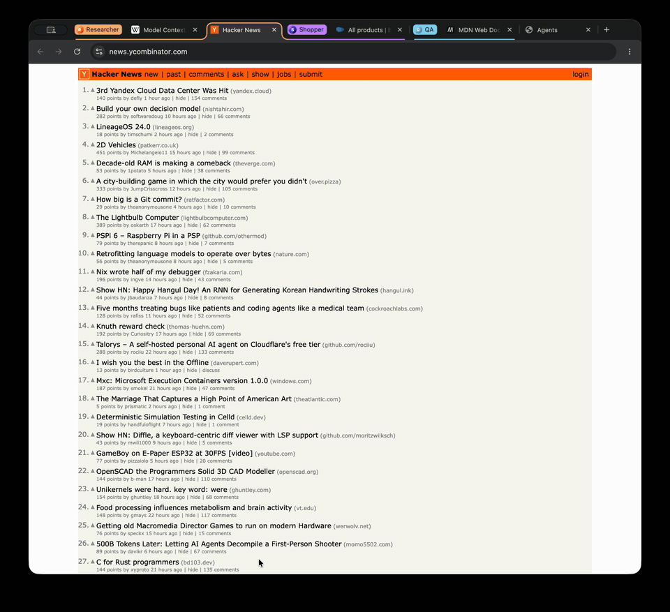

<p align="center">
  
</p>

<h1 align="center">Shuttle</h1>

<p align="center">
  <b>The browser built for AI agents.</b><br>
  Every agent gets its own logged-in identity and its own tab group in your browser,<br>
  and the MCP server is built in.
</p>

<p align="center">
  <a href="https://github.com/shuttle-browser/shuttle/releases/latest"></a>
  
  
  <a href="LICENSE-SHUTTLE"></a>
</p>

<p align="center">
  <a href="https://www.shuttlebrowser.com">Website</a> ·
  <a href="https://www.shuttlebrowser.com/download">Download</a> ·
  <a href="https://www.shuttlebrowser.com/docs">Docs</a> ·
  <a href="https://github.com/shuttle-browser/shuttle-tools">Build tooling</a>
</p>

---

<p align="center">
  
</p>

## Why Shuttle

Browser MCP servers bolt automation onto a browser that was built for people. In practice:

- **Your logins are out of reach.** Since Chrome 136, `--remote-debugging-port` is ignored on your default profile.
  Agents get a separate, empty profile, or you go through a flag-and-toggle routine.
- **Isolated or locked.** Isolated modes forget every login when they close; shared profiles lock
  ("Browser is already in use"), so only one agent runs at a time.
- **Parallel agents collide.** Agents sharing one browser fight over tabs and screenshot each other's pages.
- **Attaching to your Chrome asks for permission** with an "Allow remote debugging?" dialog and an
  "is being controlled by automated test software" banner.
- **The client sees everything.** A debugging port hands over your whole profile, to any application on your machine.
- **A chain of moving parts:** an npx or Python server, runtimes, API keys, a separate Chrome install.

Shuttle fixes this in the browser itself:

| | |
| --- | --- |
| 🧩 **Built-in MCP server** | `http://127.0.0.1:9222/mcp`, on the DevTools port. Nothing to install or keep in sync. |
| 🪪 **Agents with identities** | Each agent has a name, color and avatar, and its own persistent storage (cookies, logins, local storage), isolated from yours and from other agents. Log in once and the agent stays logged in. |
| 🗂️ **Sessions as tab groups** | An agent's tabs show up as a named, colored tab group in your normal window. Watch it work, hand it a tab, or take one back. |
| 🔌 **Per-session CDP** | Every session gets its own CDP endpoint for Playwright or agent-browser. It sees only that session's tabs and that agent's storage. |
| 🛠️ **Page tools included** | `snapshot`, `click`, `fill`, `type`, `press`, `wait-for`, `screenshot`, `get-text`, … (24 tools through a bundled [agent-browser](https://github.com/vercel-labs/agent-browser) sidecar). |
| 🤫 **Zero prompts** | No remote-debugging approval, no "controlled by automated software" infobar, `navigator.webdriver` is `false`, and no window at startup. |
| 🪶 **Lean Chromium** | Google services, sign-in, sync, telemetry, Google AI features, translate, the password manager and side panel are gone. Extensions, DevTools, PDF, printing and downloads still work. |

## Install

**macOS** (Apple silicon, signed and notarized): download `Shuttle-<version>-arm64.dmg` from
[Releases](https://github.com/shuttle-browser/shuttle/releases/latest) and drag Shuttle to Applications.

**Linux** (x64):

```bash
curl -LO https://github.com/shuttle-browser/shuttle/releases/latest/download/shuttle-linux-x64.tar.xz
tar xf shuttle-linux-x64.tar.xz && ./shuttle/shuttle
```

**Windows**: run the Linux build in WSL2 (WSLg shows its windows on your desktop).

## Quick start

1. Start Shuttle. It serves CDP and MCP on port **9222** (or the next free port, written to `DevToolsActivePort`).
   No window opens until an agent opens a tab.
2. Connect your agent:

   ```bash
   # Claude Code
   claude mcp add --transport http shuttle http://127.0.0.1:9222/mcp
   # Codex
   codex mcp add shuttle --url http://127.0.0.1:9222/mcp
   ```

   Any MCP client that speaks Streamable HTTP works with the same URL.
3. Ask it to do something:

   > Create a Shuttle agent called "Researcher", open hacker news in its tab and summarize the top 5 stories.

Open `chrome://agents` to see your agents, their sessions and tabs. You can sign in to a site *as* an agent once,
and it stays signed in.

## How it works

```
 agent (Claude Code, Codex, ...) ──MCP──▶  /mcp ─┐
                                                 ├─ agent  = identity + its own storage partition
 Playwright / agent-browser ──CDP──▶ /devtools/  ├─ session = a tab group, one per agent
                          session/<id>           └─ tab     = leased to one session
```

| MCP tool | What it does |
| --- | --- |
| `list-agents`, `create-agent`, `update-agent`, `delete-agent` | Manage agents (name, color, avatar). Deleting wipes the agent's storage. |
| `open-session`, `close-session`, `list-sessions` | A session is one task run by an agent; returns a scoped `cdpEndpoint`. |
| `allocate-tab`, `release-tab`, `navigate-tab` | Lease tabs to a session (they run at full speed in the background). |
| `capture-tab`, `set-tab-viewport` | Screenshots and device viewports (e.g. 390×844). |
| `snapshot`, `click`, `fill`, `type`, `press`, `select`, `check`, `scroll`, `wait-for`, `get-text`, `eval`, `screenshot`, … | Page tools (refs `@eN` come from `snapshot`). |

Drive a session yourself with Playwright:

```js
import { chromium } from 'playwright';
const browser = await chromium.connectOverCDP(cdpEndpoint); // from open-session
const page = browser.contexts()[0].pages()[0];              // the session's tab
await page.getByRole('link', { name: 'Sign in' }).click();
```

## Share one Shuttle across machines

Run Shuttle on a dedicated machine (a Mac mini, a Linux box) and let agents on other machines use it over your LAN or
Tailscale. Each agent keeps its own logins and tab group in the one browser.

```sh
# On the Shuttle machine: listen on all interfaces (or one IP, e.g. your Tailscale address)
open -a Shuttle --args --shuttle-listen=0.0.0.0        # Linux: ./shuttle --shuttle-listen=0.0.0.0
cat ~/Library/Application\ Support/Shuttle/ShuttleAccessToken   # Linux: ~/.config/shuttle/ShuttleAccessToken

# On any other machine
claude mcp add --transport http shuttle http://shuttle-box:9222/mcp --header "Authorization: Bearer <token>"
```

- Network mode is off by default. With `--shuttle-listen`, every client that doesn't connect over loopback needs the
  access token: `Authorization: Bearer <token>`, or `?token=<token>` for CDP clients that can't set headers.
- The token is created on first use (`ShuttleAccessToken` in the user data dir, mode 0600). Pass
  `--shuttle-access-token=<token>` to set your own; delete the file to rotate it.
- `cdpEndpoint` and `cdpUrl` from the MCP tools already carry the token, so Playwright and agent-browser connect as is.
- Local clients keep working without a token. Web pages are still rejected by the Origin check.
- Plain HTTP: use it on networks you trust, or over Tailscale/WireGuard/SSH, which encrypt the traffic.

## Status and limits

Shuttle 0.1.0 is the first public release (Chromium 154.0.8037.129).

- No auto-update yet: watch Releases. Security fixes follow Chromium stable releases with a delay.
- By default the MCP and CDP port listens on localhost only, without authentication: any local process can drive the
  browser, the same as with `--remote-debugging-port`. Network mode (above) requires a token for remote clients.
- Open codecs only (VP8/VP9/AV1/Opus): H.264-only video won't play, and there is no Widevine DRM.
- UI in English only.

## Building from source

Shuttle is Chromium plus a series of fork commits on `main` (`git log agent-chrome..main`): removals, the MCP server
(`chrome/browser/shuttle/`), agent identity, per-session CDP, and branding. The build configuration, prune scripts,
smoke tests and the removal log live in
**[shuttle-browser/shuttle-tools](https://github.com/shuttle-browser/shuttle-tools)**.

## License

Shuttle's changes are released under the [BSD-3-Clause license](LICENSE-SHUTTLE). Chromium and its third-party
components keep their own licenses (see [LICENSE](LICENSE) and `chrome://credits`). agent-browser is Apache-2.0.

Shuttle is not affiliated with Google. Chrome is a trademark of Google LLC.

<details>
<summary>About Chromium</summary>

Shuttle is built on [Chromium](https://www.chromium.org/), the open-source project behind Google Chrome. The original
Chromium README is in [README.chromium.md](README.chromium.md).

</details>
